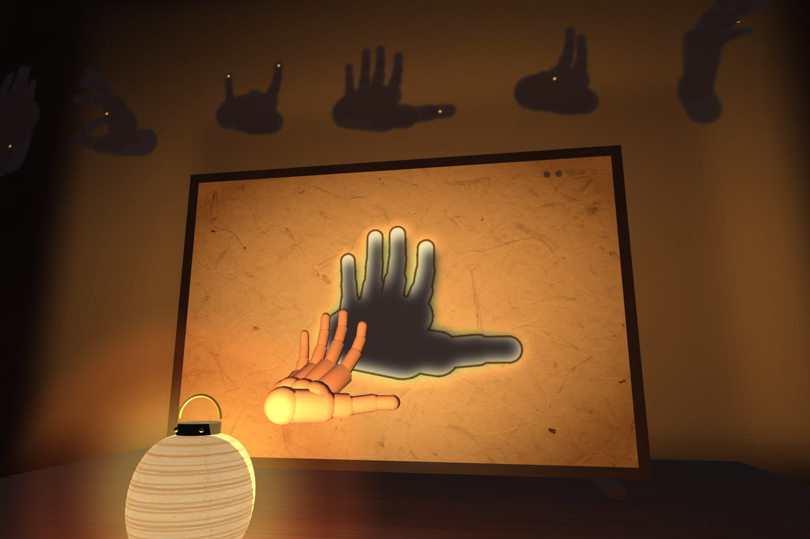

# Shadowfolk — a hand-shadow theater for Meta Quest



A paper lantern stands on your real table and a washi-paper screen stands beyond it. Raise your hands into the lantern light and their shadows fall on the paper. Each night, cut-outs of sleeping creatures wait there. Shape your hands until the shadow fits, hold it, and the creature wakes, walks off the paper, and settles on your real wall. It stays there, night after night.

**Play:** open https://cjw0076.github.io/shadowfolk/ in the Meta Quest Browser and press *Light the lantern*. Hands only, seated, a few minutes a night. Allow room access when asked, so the theater can use your table and wall. A desktop browser shows a self-playing preview.

## What the room does
- **Table:** if a table is under the lantern (WebXR plane and mesh detection), the theater stands on it, with the lantern on a small wooden stand and a warm light pool on the real table top.
- **Wall:** if you sit close to a wall, the paper is taped to the real wall at the exact distance the shadows need.
- **Collection:** creatures you wake leap onto the real wall behind the paper and live there as shadows with glowing eyes.
- **Anchor:** the spot is saved with a persistent spatial anchor; next time the theater is waiting where you left it.
- **Carry it:** pinch the lantern to pick the whole theater up, and open your fingers to set it down somewhere else.
- **Lights down:** the room dims around you while the lantern stays bright.

## Each night
- **Five sleeping shapes**, the newcomer saved for last. Each night has a name ("Night 1 · The First Lantern").
- **Wake:** fit and hold. The cut-out flares, the creature fills with ink and opens its eye, follows your hand for a moment, then walks off in its own gait (hop, crawl, swim, flap, stalk, scuttle).
- **Parade:** after the last shape, the night's creatures parade across the paper and the next newcomer is teased.
- **Invent your own:** then the paper is blank. Hold any shape still and it is born as a new creature with its own name, and it joins your wall.
- **Tonight's moon:** a moon cut into the paper's corner follows the real lunar phase.

## How it works
- **Live shadows.** Every frame, the 25 tracked joints of each hand are projected from the lantern onto the paper's plane (`src/shadow/silhouette.ts`). The penumbra widens as a hand moves toward the light.
- **Fitting a shape.** The live shadow is rasterised, normalised for position and size, and compared with the creature's template over ±30° of rotation and either hand. The comparison is an intersection-over-union weighted toward the fingertips.
- **Reachable creatures.** Every cut-out is the shadow of a real hand pose: captured hand data bent with forward kinematics and cast through the same lantern geometry (`src/shadow/hand-model.ts`, `src/shadow/targets.ts`).
  - 11 creatures: 8 single-hand and 3 two-hand (butterfly, stag, crab).
  - Pass thresholds are calibrated in simulation against noisy attempts and hundreds of casual hands (`tools/eval-targets.ts`).
- **Room fitting without distorting the optics.** The lantern-to-paper distance never changes; the whole rig is moved onto a table or a wall instead (`src/theater/room.ts`).
- **Quest budget.**
  - Only a quarter-resolution shadow layer is uploaded per frame; paper, cut-outs and creatures are cached layers and sprites (`src/theater/painter.ts`).
  - Fixed foveation and a 72 Hz request in XR (`src/theater/xr-render.ts`).
- **Sound.** All of it is synthesised with Web Audio: a lantern drone and flame crackle in 3D at the lantern, creature voices, chimes and a generated reverb.
- **Help without text.** The lantern waits as an ember until your hand enters its light. If a shape does not come, a ghost hand shows it.
- **See the optics:** add `?rays` to the URL to draw the light rays from the lantern through each fingertip to the paper.

## Verification
- `tools/check-runtime-browser.mjs`: runtime fault checks (storage, pause and resume, hand loss, audio).
- `tools/check-matcher.ts`: matcher exactness.
- `tools/check-static-canvas-backing.mjs <preview-url>`: static paper and wall textures use CPU-backed canvases; the live shadow keeps its GPU 2D path.
- `tools/browser/xr-e2e-all.mjs`, `xr-room-e2e.mjs`: end-to-end in the IWER emulator with real emulated XR hand joints through `readHands`, the matcher and the wake.
  - All 11 creatures wake.
  - Seven near-miss inputs never wake.
  - The persistent anchor restores after the session ends.
  - Pinch carry and pinned-to-wall mode work.
- `tools/record/record.mjs`: frame-exact capture (`?capture`) with an offline-rendered soundtrack; the demo video is filmed with it.

## Develop
```sh
npm install
npm run dev        # managed dev server + IWER emulator
npm run typecheck
npm run build
```

## Credits
- Base hand poses are derived from the captured hand configurations in [IWER](https://github.com/meta-quest/immersive-web-emulation-runtime) (MIT, Meta Platforms).
- Textures were generated for this project; see `public/textures/CREDITS.md`.
- Playfair Display is used under the SIL Open Font License (`public/fonts/OFL.txt`).
- All sound is synthesised at runtime.
